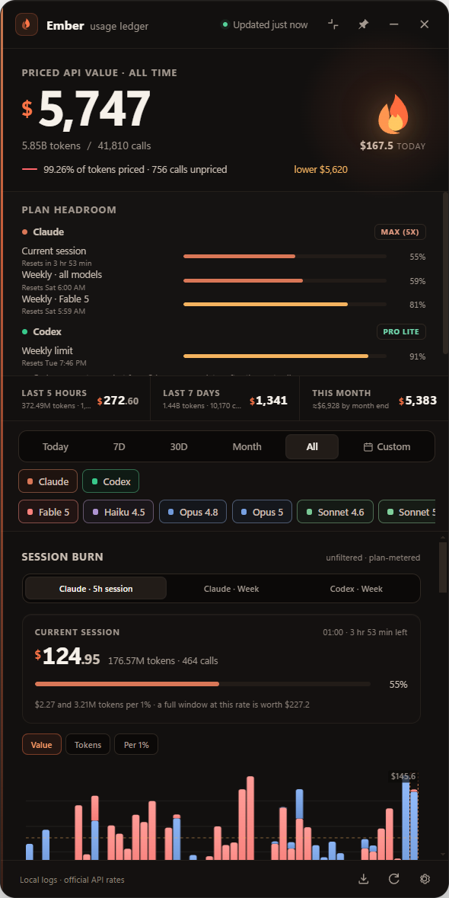
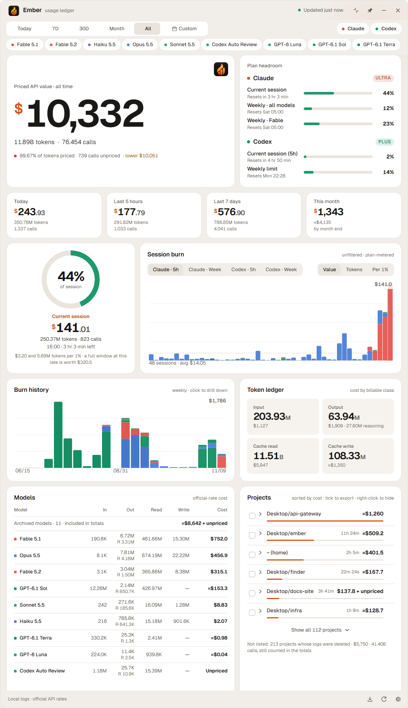
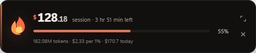

<div align="center">


# Ember

### Your AI coding burn, without the blind spots.

One private desktop ledger for **Claude Code, Codex, OpenCode and Oh My Pi**:<br />
what you used, what it would have cost at API rates, and how much plan you have left.

[](https://github.com/HarshalVankudre/Ember-usage-widget/releases/latest)
[](https://github.com/HarshalVankudre/Ember-usage-widget/releases)
[](#install)
[](https://tauri.app/)
[](LICENSE)

**[Download](https://github.com/HarshalVankudre/Ember-usage-widget/releases/latest)** ·
[Features](#features) ·
[Accuracy](#how-the-number-is-worked-out) ·
[Session burn](#session-burn) ·
[What it reads](#what-ember-reads) ·
[FAQ](#faq) ·
[Build](#build-from-source)

<br />

<table>
  <tr>
    <td></td>
    <td></td>
  </tr>
</table>

<sub>The whole ledger on one portrait 1080p screen, dark or light · local logs · live limits · official API rates · no account, no telemetry</sub>

</div>

---

## Why Ember

A subscription makes AI coding feel unlimited until a meter turns red, and the provider's "you are N% through your quota" tells you nothing about what that percent was worth. Ember reads the logs already on your machine and answers three questions:

| | Question | What Ember shows |
|:-:|---|---|
| 🔥 | **How much plan do I have left?** | Claude and Codex session and weekly limits, including Claude's separate Fable quota, with reset countdowns |
| 💵 | **What was that usage worth?** | Every request priced at the provider's official published rate, on the day it was made |
| 📈 | **Is my allowance changing?** | A history of every session window, and what one percent of plan bought in each |

> [!IMPORTANT]
> Ember shows the **API-equivalent value** of subscription usage. It is not your Claude or ChatGPT invoice.

## Features

**One screen**

- A grid of cards that shows the whole ledger at once on a portrait 1080p monitor, with nothing to scroll
- Cards sit side by side in any wide window and fold to a single column in a narrow one
- Long lists (models, projects) scroll inside their own card, so the page stays still

**The ledger**

- One headline figure for combined Claude and Codex API-equivalent value, with a lower bound when part of it is estimated
- Last 5 hours, last 7 days and month to date, with a month-end projection
- Period comparison against the same stretch before it, cut off at the same time of day
- Token ledger by billable class: input, output (with reasoning), cache reads, cache writes

**Slicing**

- Provider and model filters, and a model table that doubles as a filter
- Interactive daily burn chart with drill-down and custom date-and-time ranges
- Per-project breakdowns, model by model, with agent working time per turn
- Hide a project before a screen share, or archive it out of the list

**Plan headroom**

- Live session and weekly bars for both providers, on a poller that backs off and recovers
- A ring for the window that is open right now: percent used, value so far, time left
- [Session burn](#session-burn): what one window costs and what a percent of plan buys
- Current plan names, including Anthropic's Max and Ultra

**Living on the desktop**

- [Compact mode](#compact-mode), tray residency, always-on-top, autostart, Windows 11 acrylic
- Six themes: Ember dark and light, Ember Noir, Catppuccin, Tokyo Night and Rosé Pine
- Export to CSV or JSON, or copy a Markdown summary

## How the number is worked out

Ember prices each request on its own, under its own provider, before anything is added up. These are the rules it follows.

| Rule | What it means |
|---|---|
| **Official rates only** | A model is priced only when its provider publishes a price for that exact model. The price tables refresh daily from the providers' own pricing pages and are cached for offline use. |
| **The rate on the day** | A call is priced at what the provider charged when it was made. GPT-5.6 Luna and Terra were cut on 30 July 2026 and GPT-5.6 Sol on 21 August 2026; earlier usage keeps the earlier price. |
| **The tier you ran at** | Fast, Flex, Batch and Ultrafast are read per call from the logs and priced at their own published rates. |
| **Every billed token, once** | A streamed Claude reply is logged several times; only the finished copy, with the real output count, is counted. Sessions replayed by a resume or a fork are deduplicated. |
| **Caching, as billed** | Cache reads at each model's own discount. Claude's 5-minute and 1-hour writes as logged. Where a Codex log does not report writes, the write premium is shown as a labelled estimate with a lower bound. |
| **Request-level modifiers** | Long-context tiers, US data residency, Claude's long-prompt tier, advisor-model passes and web-search fees are applied where the logs show them. |
| **No guessing** | Where no published price exists, the dollar value is left out and the calls are marked **Unpriced**. Their tokens and calls stay in every total, and the line under the headline says how much of your traffic was priced. |

The bundled price tables are tested row by row against saved copies of the official [Anthropic](https://platform.claude.com/docs/en/about-claude/pricing) and [OpenAI](https://developers.openai.com/api/docs/pricing) pricing pages, so a rate that drifts fails the build.

<details>
<summary><strong>Billing details, provider by provider</strong></summary>

<br />

| Billing detail | Claude | Codex |
|---|---|---|
| Input and output | Official per-model rates; the finished copy of each streamed response is the one counted | Official per-model rates, at the price in force on the day of the call |
| Cache reads | Each model's own cache-hit rate (0.1×, 0.05× or 0.025× input) | Each model's cached-input rate |
| Cache writes | Logged 5-minute (1.25×) and 1-hour (2×) writes | Measured when a positive count is logged; otherwise an estimate range. Codex logs a literal 0 even for prompts the next call reads back from cache |
| Speed and tier | Fast mode at each model's published fast rate; batch at half | Fast, Flex, Batch and Ultrafast as logged per call |
| Context length | Haiku 5.5's long-prompt tier above 100,000 prompt tokens | Long-context tier above 272,000 input tokens, only for models OpenAI publishes in tiers |
| Other | US inference geography (1.1×), advisor-model passes at the advisor's rates, web-search fees | Reasoning reported as part of output, never added twice |
| Unknown pricing | Value omitted and marked **Unpriced** | Value omitted and marked **Unpriced** |

A model id carries an optional dated snapshot suffix and nothing more. A trailing `-pro`, `-fast` or `-spark` is a different product with its own rate, so those never inherit the base model's price.

OpenAI model ids used through a Claude Code compatibility gateway or OpenCode's OpenAI provider are attributed to Codex and priced with OpenAI's rules. Oh My Pi's `anthropic`, `openai` and `openai-codex` rows are folded into the same Claude and Codex model rows and priced with the same official tables, not with the cost OMP stored, so one model is never valued at two prices. Other vendors' models that turn up in a Claude-shaped gateway transcript, and internal `nexus-gpt-*` traffic, are left out of every total.

The long-context surcharge is read from the provider's own table rather than assumed from a model family: a model whose published price is flat is billed flat however large the request.

</details>

## Session burn

Both providers publish one number, "you are N% through your quota", and nothing else. There is no history and no record of what that percent used to buy, so an allowance that quietly moves looks exactly like one that never changed. Ember keeps the record the meters do not, from two independent sources:

- **Reconstruction.** A Claude session window opens on the first call and closes five hours later, anchored to the top of the hour. Replaying that rule across your logs measures every 5-hour block you have ever worked, available the moment you install.
- **Observation.** Ember samples each plan meter it can see and remembers every window it watched, with the peak utilization the provider reported. Pairing a window with the usage recorded inside it gives the figure neither provider publishes: **tokens, and API-equivalent value, per one percent of plan.**

Where the two overlap, the observed window wins, because its boundaries are the provider's own. Windows Ember never watched keep their tokens and value and carry no percentage rather than borrowing a neighbour's.

Switch between **Value**, **Tokens** and **Per 1%** to compare windows in the chart. Bars are stacked by model, so a shift explained by model mix looks different from one that is not. Weekly quotas get the same treatment, anchored to your account's own reset time.

> [!NOTE]
> On 30 October 2026 Anthropic renamed **Max 20x to Ultra** and Max 5x to **Max**, and removed the 5-hour limit for verified Ultra accounts. Ember shows the new names. Once your account stops reporting a 5-hour window, the "Current session" bar and the 5h view give way to the week; an unverified Ultra account keeps its temporary 5-hour limit, and Ember keeps showing it.

The session-burn panel ignores the date, provider and model filters on purpose. A plan meter counts everything, so a filtered view would not be comparable to it.

## Compact mode

Collapse Ember to a strip that keeps the live window on screen while you work: value spent, quota consumed, time left. Double-click to expand, or use the tray.

<div align="center"></div>

## What Ember reads

Everything is read in place, from files the tools already write.

| Tool | Where the usage comes from | |
|---|---|:-:|
| Claude Code, in the terminal, an IDE or the desktop app's Code tab | `~/.claude/projects/**/*.jsonl` | ✅ |
| Codex CLI, IDE extension and desktop app | `~/.codex/sessions` and `archived_sessions` | ✅ |
| A relocated or second Codex home | `CODEX_HOME`, and Orca's Codex runtime home | ✅ |
| OpenCode (OpenAI provider) | `~/.local/share/opencode/opencode.db` | ✅ |
| Oh My Pi (Anthropic, OpenAI and OpenAI-Codex rows) | `~/.omp/stats.db` | ✅ |
| ZCode (Kimi and Qwen models; GLM is left out) | `~/.zcode/cli/db/db.sqlite` | ✅ |
| Claude Code on another machine (a server on the same plan) | Its `~/.claude/projects`, copied over `ssh`. See [Usage from a server](#usage-from-a-server) | ✅ |
| Claude plan limits | Anthropic's account API, read-only, with Claude Code's existing sign-in | ✅ |
| Codex plan limits | `rate_limits` snapshots in the rollout logs | ✅ |
| Chat in the Claude or ChatGPT apps and on the web | Not recorded on your machine, so it cannot be priced | — |

ZCode's models are not Claude or OpenAI models, so they appear as a third provider, valued against a dated snapshot of the OpenRouter catalog. That figure is an approximation: OpenRouter's price depends on which upstream served the request, and ZCode does not record it.

Chat usage still moves the plan bars, because those percentages come from the provider and cover your whole account. It is outside Ember's token totals, which makes a measured "per 1%" rate a floor rather than a ceiling.

## Usage from a server

If you run Claude Code on a server or a second computer signed in to the same plan, Ember can add that usage to the totals on your desktop. The plan bars already cover it, because they come from your account. This adds the tokens and the value.

Ember connects with the `ssh` client that ships with Windows 11. About once a minute it copies the remote machine's Claude Code logs into its data folder, and it prices them exactly like local ones. Only new bytes are sent, so once the first copy is done a quiet sync is just a file listing. You don't install anything on the server. It needs a Linux shell and the usual tools (`find`, `tail`, `awk`).

1. Make sure `ssh you@your-server` works from PowerShell **without a password prompt** (a key, not a password). Ember runs ssh in batch mode, so it can't answer prompts.
2. Open `remote-sources.json` in Ember's data folder (`%APPDATA%\com.harshalvankudre.ember-widget`) and add the server:

```json
{
  "intervalSeconds": 60,
  "sources": [
    { "name": "vps", "ssh": "you@203.0.113.7" }
  ]
}
```

3. Save the file. No restart is needed: within a minute the server's projects show up as `vps · <project>`, and the totals, charts and session windows include them.

A light for each server sits in the titlebar: **green** when the last sync worked, **amber** while connecting or if the last success is more than a few minutes old, **red** when it can't connect (hover for the reason), and **grey** when paused. Click it to pause or resume that server. A paused server's usage that has already been synced stays in the totals.

`ssh` can also be a host alias from your `~/.ssh/config`. Optional fields: `port`, `identityFile`, `remotePath` (default `.claude/projects` under the remote home), `sshPath` and `enabled`. The outcome of each sync is written to `remote-sources-status.json` and `ember.log` in the same folder. The copies live under `remote\<name>\`, so the server's history stays in Ember even if its logs are later deleted, the same as for local logs.

## Install

Ember runs on **Windows 11**. 22H2 or newer is recommended for the acrylic material.

1. Open the **[latest release](https://github.com/HarshalVankudre/Ember-usage-widget/releases/latest)**.
2. Run `Ember_<version>_x64-setup.exe`. It is a one-click, per-user install with shortcuts, tray and autostart.
3. Launch Ember. Your existing Claude Code, Codex, OpenCode and Oh My Pi sessions appear automatically.

No API keys, no account, no database to set up. Coming from an Electron-era Ember (1.x)? Usage history, quota history and settings carry over on first launch.

Since 2.0, Ember is a native [Tauri](https://tauri.app/) app on Windows 11's built-in WebView2. There is no bundled Chromium or Node runtime, so the installer and the memory footprint are a fraction of the Electron build's.

## How it works

```text
Claude Code logs ─┐
Codex rollouts ───┼─► normalize ─► price per request ─► local history ─► Ember
OpenCode DB ──────┤                                          ▲
Oh My Pi stats ───┘                                          │
                                                             │
plan meters ──────► quota ledger (every window Ember watched)─┘
```

A write to a log reaches the screen in about a tenth of a second, with a reconciliation sweep every few seconds behind it. An unchanged sweep costs a parallel `stat` pass rather than a full re-price. When new usage lands, Ember schedules one catch-up read of the plan meters so headroom tracks the burn without hammering an endpoint that rate-limits hard.

Parsed records live in Ember's own cache, so cleaning up old session logs does not erase your history. Projects whose logs are gone stay out of the project list; a line under it says how many there are and what they add up to.

<details>
<summary><strong>How working time is measured</strong></summary>

<br />

Working time is recorded per turn. For Claude Code, a turn runs from the prompt to the final reply, and Claude Code's own `turn_duration` is used whenever the log has one. For Codex, a turn runs from `task_started` to `task_complete`.

Each turn counts toward the project, model and day it finished on, so per-model times add up to the project's total. Subagent work is already inside the turn that called it. A turn that is still running adds nothing until it finishes, and a session closed mid-turn counts up to its last call once its log has been quiet for 30 minutes. Oh My Pi, OpenCode and ZCode record requests but not turns, so they add no time.

</details>

## Export

The export menu in the footer writes whatever is on screen, and only where you choose to put it.

| Export | Contents |
|---|---|
| Copy summary | Markdown block with the headline, rolling windows and the recent session table |
| Session windows · CSV | One row per window: tokens, value, quota percent, value per 1%, projected full window |
| Current view · CSV | Day × model rows under the active filters |
| Current view · JSON | Totals, models, projects and windows in one structured file |

## Privacy

Ember has no telemetry and no cloud account. Usage history, quota history, settings and price caches stay on your machine. It talks to three addresses, read-only: Anthropic's and OpenAI's public pricing pages, about once a day, and Anthropic's account API for your plan limits, using the sign-in Claude Code already has. From the Oh My Pi, OpenCode and ZCode databases it selects only the accounting columns, never prompts, responses or tool output.

## FAQ

<details>
<summary><strong>Why doesn't this match my bill?</strong></summary>

<br />

It is not meant to. On a subscription you pay a flat fee; Ember shows what the same usage would have cost through the API. That is the number that tells you what your plan is worth to you.

</details>

<details>
<summary><strong>My all-time total changed after updating. Was something counted twice?</strong></summary>

<br />

No. The call and token counts are the same; the prices applied to them were corrected. Versions before 2.1.3 priced all history at today's rates, missed the Fast tier on current Codex logs, and under-read the output of streamed Claude replies. Each correction raises the figure, so totals go up, most of all if you used GPT-5.6 Sol before its August 2026 price cut.

</details>

<details>
<summary><strong>Does it count what I do in the Claude or ChatGPT chat apps?</strong></summary>

<br />

Coding sessions, yes: the Claude desktop app's Code tab and the Codex desktop app write the same logs as their command-line tools. Ordinary chat, no: neither app records token counts on disk. Chat still shows up in the plan bars.

</details>

<details>
<summary><strong>Why are some calls "Unpriced"?</strong></summary>

<br />

Their model has no published API price, for example Codex-only variants and internal review models. Ember leaves the dollar value out rather than borrow another model's rate. The tokens and calls are still counted.

</details>

<details>
<summary><strong>Why is there a "lower" figure next to the headline?</strong></summary>

<br />

Codex logs do not say how much of each prompt was written to cache, and GPT-5.6 and later bill those tokens at 1.25× input. The headline counts all new input as written, which is the upper bound; the lower figure counts none.

</details>

<details>
<summary><strong>Can I correct a price myself?</strong></summary>

<br />

For Claude models, yes. Edit `pricing-overrides.json` in Ember's data folder (`%APPDATA%\com.harshalvankudre.ember-widget`). Rows under `"claude"` beat both the live and the bundled table, and Ember reloads the file as soon as it is saved. OpenAI prices come only from the official page and the bundled table.

</details>

## Build from source

Requires [Node.js](https://nodejs.org/) with npm and a [Rust](https://rustup.rs/) toolchain.

```bash
git clone https://github.com/HarshalVankudre/Ember-usage-widget.git
cd Ember-usage-widget
npm install
npm start      # tauri dev
```

```bash
npm test       # renderer checks (node) + pricing, limits, quota math, attribution, parsing (cargo)
npm run dist   # tauri build: NSIS installer plus a standalone executable
```

The backend lives in `src-tauri/` (Rust) and the renderer in `src/renderer/` (plain HTML, CSS and JS over the `window.api` bridge).

To check the aggregation against your own logs, point the ignored tests at a **copy** of Ember's data folder; they print per-model calls, tokens and value for an independent recount:

```bash
EMBER_VERIFY_DIR=/path/to/copy cargo test --manifest-path src-tauri/Cargo.toml real_ -- --ignored --nocapture
```

When a provider changes its prices, save the new pricing page into `src-tauri/src/providers/fixtures/` and the row-by-row tests will show which bundled rates need to move.

For work on the interface, the ignored `dump_preview_payload` test writes the usage, limits and quota payloads to `preview-payload.json` in that same folder, so the renderer can be opened in a browser with a stubbed `window.api` instead of inside the app.

## Author

Created and maintained by **[Harshal Vankudre](https://github.com/HarshalVankudre)**.

The interface is set in [Geist](https://vercel.com/font) (SIL Open Font License), bundled with the app so nothing is fetched at run time.

The Ember mark combines a flame with rising usage-meter bars (`src/assets/logo.png`; regenerate the in-app and Windows icons with `scripts/render-logo.ps1`). Ember grew from the original Claude and Codex usage widgets into a single, provider-aware ledger.

## License

[MIT](LICENSE) © Harshal Vankudre
